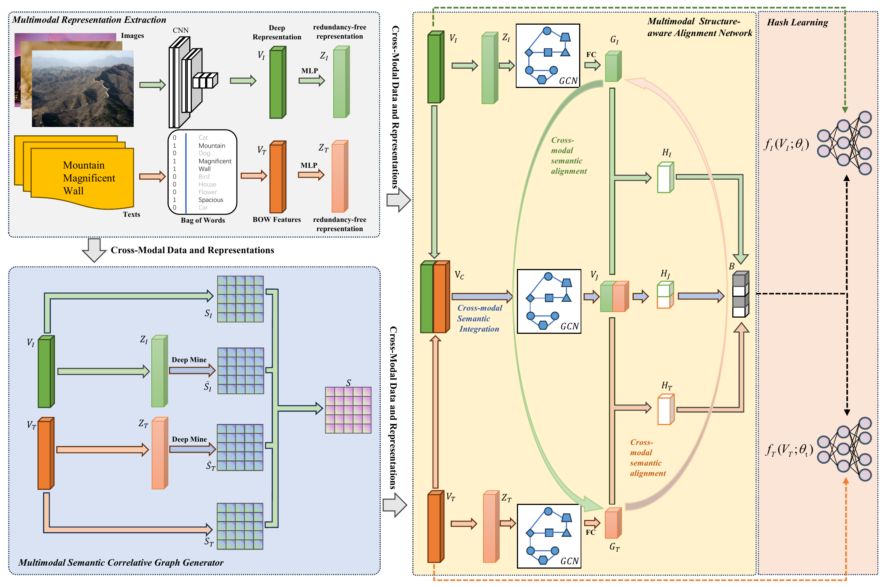

# SACH

Verified local release candidate for **Structure-aware contrastive hashing for unsupervised cross-modal retrieval** by Jinrong Cui, Zhipeng He, Qiong Huang, Yulu Fu, Yuting Li, and Jie Wen. *Neural Networks* 174 (2024), 106211. The code corrects the hash-function similarity target indexing, saves both hash heads, and reports full-gallery MAP. The indexing fix changes the training objective applied to shuffled batches. A bounded synthetic run passed with actual Lightly 1.4.3 and CUDA. The published experiments remain unverified. [Paper](https://doi.org/10.1016/j.neunet.2024.106211) · [Reproducibility status](docs/reproducibility_status.md)

SACH learns separate image and text hash functions for bidirectional retrieval. The training implementation combines coarse and cluster-derived similarities for graph propagation, aligns graph features with a contrastive loss, and uses a joint code generator to supervise the modality hash functions.

## Framework



## Training

From this directory, inspect the preset options with `python main_mir.py --help`. The original command names and experiment defaults are retained. Training requires compatible precomputed feature/label splits, CUDA, and the runtime packages listed in the baseline notes.

```sh
python main_mir.py --DATA_ROOT ./datasets --LOG_DIR ./logs
python main_nus.py --DATA_ROOT ./datasets --LOG_DIR ./logs
python main_coco.py --DATA_ROOT ./datasets --LOG_DIR ./logs
```

COCO is an exploratory path in the snapshot. The paper reports MIRFlickr-25K and NUS-WIDE. Use a new `--LOG_DIR` for separate runs because logs append. Best checkpoints are written to a new run directory under `--MODEL_DIR`. [Setup and workflow](docs/baseline.md) · [Paper-to-code mapping](docs/paper_to_code_mapping.md) · [Implementation notes](docs/implementation_notes.md) · [Known issues](docs/known_issues.md)

## Standalone evaluation

From the repository root, pass the checkpoint path printed by training and its hash width. Replace the example run directory with your own. Use a trusted checkpoint containing the `ImgNet` and `TxtNet` state dictionaries. Relative paths resolve from the working directory.

```sh
python -m sach.evaluate --DATASET MIRFlickr --CHECKPOINT ./checkpoints/run-123/MIRFlickr_16bits.pth --DATA_ROOT ./datasets --HASH_BIT 16 --DEVICE cpu --LOG_DIR ./eval-logs
python -m sach.evaluate --DATASET NUSWIDE --CHECKPOINT ./checkpoints/run-456/NUSWIDE_32bits.pth --DATA_ROOT ./datasets --HASH_BIT 32 --DEVICE cuda:0 --LOG_DIR ./eval-logs
```

`--DEVICE` defaults to `cpu`. Use `cuda` or `cuda:0` for the first visible CUDA device. `--HASH_BIT` and `--BATCH_SIZE` default to the selected preset. Specify `--HASH_BIT` whenever the checkpoint was trained at a different width. `--DATA_ROOT` and `--LOG_DIR` default to `./datasets` and `./logs`. The dataset-specific launcher remains available, for example:

```sh
python main_mir.py --TRAIN False --CHECKPOINT ./checkpoints/run-123/MIRFlickr_16bits.pth --HASH_BIT 16 --DATA_ROOT ./datasets --DEVICE cpu --LOG_DIR ./eval-logs
```

| `--DATASET` | Required files under `--DATA_ROOT` |
|---|---|
| `MIRFlickr` | `MIRFlickr/mir_query.mat`, `MIRFlickr/mir_database.mat` |
| `NUSWIDE` | `NUS-WIDE/nus_query.mat`, `NUS-WIDE/nus_database.mat` |
| `COCO` | `MSCOCO/COCO_query.mat`, `MSCOCO/COCO_database.mat` |

The query file contains `I_te`, `T_te` and `L_te`. The gallery contains `I_db`, `T_db` and `L_db`. The COCO gallery uses the existing HDF5 layout. Evaluation loads precomputed features for both splits and constructs the two hash heads. It requires neither training split files, the training similarity graph, nor Lightly.

The CLI prints `MAP (full gallery) I->T: <score>, MAP (full gallery) T->I: <score>` and the log path. It creates the output directory if needed and appends a record with the two scores, checkpoint, dataset and device to `evaluation_<dataset>_<bits>bits.txt`. The checkpoint is read only. See `python -m sach.evaluate --help` for the full option list.

## Repository map

| Path | Responsibility |
|---|---|
| `main_mir.py`, `main_nus.py`, `main_coco.py` | Launch the corresponding archived preset. |
| `sach/config.py`, `sach/cli.py` | Experiment defaults, path arguments and the shared epoch driver. |
| `sach/data.py` | MATLAB/HDF5 split readers, paired dataset and PyTorch loaders. |
| `sach/models.py` | Teacher, modality hash heads, graph layers and attention modules. |
| `sach/trainer.py` | Global affinity, losses, two training passes, retrieval evaluation and checkpoint entry points. |
| `sach/checkpoint.py` | Run-specific checkpoint paths, atomic writes and two-head restore. |
| `sach/evaluate.py`, `sach/evaluation.py` | Standalone evaluation, shared encoding and retrieval metrics. |
| `sach/run_logging.py` | Training log handlers. |
| `tests/` | Focused correctness tests and bounded comparisons with the original and Phase 2A snapshots. |

## Source provenance

The snapshot contains code adapted from CIRH, including loader, hash-head and second-stage training code. The exact CIRH revision and permission to redistribute the inherited sections remain unverified. The authors' publication citation and the upstream code attribution both apply. Code redistribution rights and terms for feature, label and image assets require separate confirmation before publication. [CIRH code](https://github.com/XizeWu/CIRH) · [CIRH paper](https://doi.org/10.1109/TKDE.2022.3218656)
